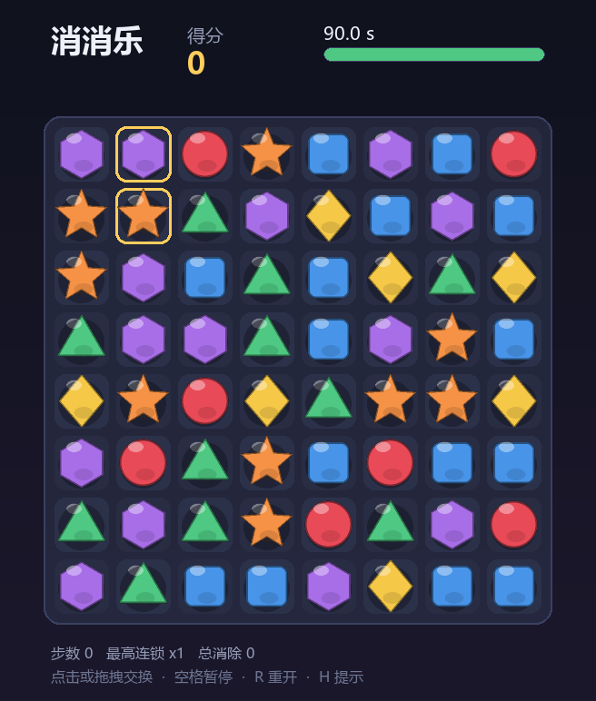
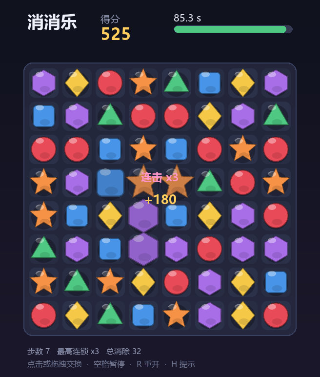
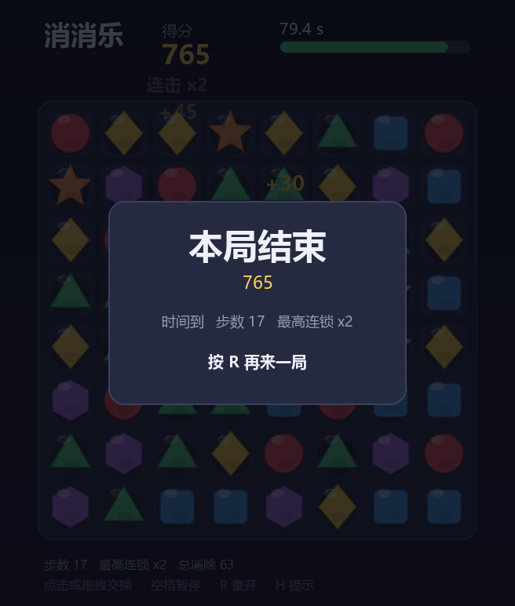

# 消消乐 · Match-3

[](https://github.com/201634924cyh/match3/actions/workflows/selftest.yml)

用 **pygame** 手写的一个消消乐小游戏。单文件、零外部素材 —— 所有宝石图案、背景渐变、
音效都是代码实时生成的，clone 下来直接就能跑。



## 特性

- **8×8 棋盘、6 种宝石**，开局棋盘保证既没有三连、也一定有解（不会一上来就是死局）
- **连带消除**：一次落下引出新三连会自动累加连击（combo），分数倍率随之上涨
- **死局自愈**：无解时自动重排，不会卡住
- **提示系统**：闲置 5 秒高亮一组可交换的位置，也可以按 `H` 主动要提示
- **90 秒计时**，倒计时条按剩余时间绿 → 黄 → 红渐变
- **全部美术与音效由代码生成**：宝石是 2 倍超采样后 `smoothscale` 下来的多边形，
  音效是 numpy 合成的正弦/三角波，仓库里没有一个图片或音频文件

| 消除中（L 形五连） | 结算 |
| --- | --- |
|  |  |

## 运行

需要 Python 3.8+。

```bash
pip install -r requirements.txt
python match3.py
```

Windows 上双击 `run.bat` 也行，macOS / Linux 用 `./run.sh`。

想固定一局棋盘（比如复现某个局面）可以传种子：

```bash
python match3.py --seed 20261111
```

## 操作

| 操作 | 说明 |
| --- | --- |
| 鼠标点击两格 | 选中相邻的两格进行交换 |
| 鼠标拖拽 | 从一格往相邻方向拖，松手即交换 |
| `空格` | 暂停 / 继续 |
| `H` | 请求提示 |
| `R` | 重开一局 |
| `Esc` | 退出 |

交换后如果凑不出三连，两块会自动弹回去，不计步数。

## 计分

```
单次得分 = 基础分 × 连击倍率
基础分   = 消除格数 × 10  +  四连奖励 20  +  五连及以上奖励 50
连击倍率 = 1 + 0.5 × (连击数 - 1)
```

比如一次四连、是第 2 段连锁：`(4×10 + 20) × 1.5 = 90`。

## 项目结构

```
match3.py              主程序（逻辑 + 渲染 + 音效，单文件）
selftest.py            无窗口自检，494 项断言
tools/make_preview.py  离屏渲染 preview/ 下的截图
preview/               预览图
run.bat / run.sh       启动脚本
```

## 自检

```bash
python selftest.py
```

走 `SDL_VIDEODRIVER=dummy`，不弹窗口、不出声，覆盖常量、边界与邻接、匹配识别、
死局判定、棋盘生成、计分公式、下落补充、坐标换算、状态机、整局模拟、渲染、性能
共 12 组、494 项断言。当前耗时约 1 秒。

其中两条值得一提：

- **死局样本必须用 `(r+c) % 3` 的对角线周期布局**。看起来更像"死局"的 `(r+c) % 2`
  交替棋盘其实有解 —— 交换 `(0,1)` 与 `(1,1)` 就能凑出首行三连，自检里专门留了一条
  断言盯着这件事，防止以后把它当成死局样本用。
- **整局模拟走 `try_drag` 而不是直接调 `begin_swap`**。后者是内部原语，绕过"时间到
  就不能再落子"的校验；曾经因为这一点，模拟局在倒计时归零后还能无限续命。

## 说明

`Game.update()` 里的计时器在交换、消除、下落的动画期间也照常走时。如果只在空闲状态
扣时间，手速快的玩家就能靠动画时长白赚，连锁越长赚得越多 —— 这不是设计意图。

## License

MIT
